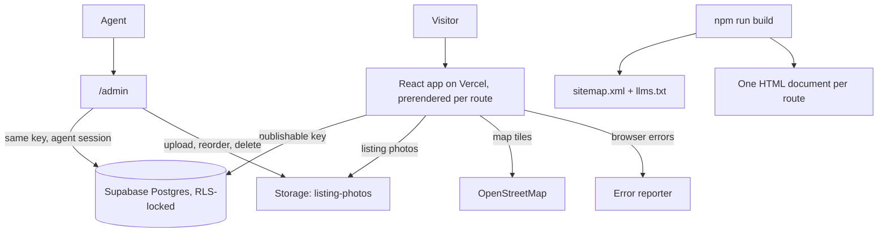

<p align="center">
  
</p>

<h1 align="center">djrxexcellence.com</h1>

<p align="center">
  <b>Homes in Dayton, Texas and the seven towns either side of it.</b>
</p>
<p align="center">
  The site for Dylan Jordan of RE/MAX Excellence: listings, saved searches and a
  listing dashboard on one React application.<br />
  Live at <a href="https://djrxexcellence.com">djrxexcellence.com</a>.
</p>
<p align="center">
  <sub>Published for reading. Proprietary — see <a href="LICENSE.md">LICENSE.md</a>. Outside contributions are not accepted.</sub>
</p>

<p align="center">
  
  
  
  
  
  
</p>

<br />

## What it does

Buyers and sellers search every published listing, save the ones worth a second
look, save the search itself, put up to four homes side by side, and ask a
question on the listing page where the answer stays for the next person reading
it. The agent works the same site from `/admin`: listings are written,
published and taken down there, photos are uploaded and reordered, leads are
triaged, comments are moderated and testimonials are published.

<table width="100%">
  <tr>
    <td width="50%" valign="top">
      <p align="center"><b>A document per route</b></p>
      <p align="center">Every static route and all eight area pages get their own HTML at build time, with their own title and canonical. A crawler reads bytes.</p>
    </td>
    <td width="50%" valign="top">
      <p align="center"><b>The database is the fence</b></p>
      <p align="center">Every read and write goes through the publishable key. Row-level policies decide which rows an account touches; grants decide which statements it may issue.</p>
    </td>
  </tr>
</table>

<br />

## Stack

| Layer       | Technology                                                              |
| :---------- | :---------------------------------------------------------------------- |
| UI          | React 19 + React Router 7                                               |
| Build & dev | Vite 7, with the sitemap and prerender steps hung off `npm run build`   |
| Styling     | Tailwind CSS 3, on the token block in `src/index.css`                   |
| Icons       | `lucide-react`                                                          |
| Maps        | Leaflet 1.9 over OpenStreetMap tiles, imported only when a map is shown |
| Backend     | Supabase Postgres, Auth and Storage                                     |
| Footer      | `@taylorurl/split-rail`                                                 |
| Hosting     | Vercel, with the rewrites and headers in `vercel.json`                  |
| Runtime     | Node 22                                                                 |

## Getting started

```bash
npm install
cp .env.example .env.local   # the Supabase project URL and publishable anon key
npm run dev
```

Those two variables are the whole of the configuration the site needs. Without
them it still builds and renders: `isConfigured` is false, and every screen that
reads the database says so rather than failing.

`docs/SETUP.md` covers the Supabase side: creating the project, applying the
migrations, promoting the agent account, seeding sample inventory, and the
config tokens the office still has to supply.

### Scripts

| Script                    | Does                                                                                                         |
| :------------------------ | :----------------------------------------------------------------------------------------------------------- |
| `npm run dev`             | Start the Vite dev server.                                                                                   |
| `npm run build`           | Write the sitemap, build to `dist`, then prerender every route.                                              |
| `npm run preview`         | Serve the built `dist` locally.                                                                              |
| `npm run lint`            | Lint with ESLint.                                                                                            |
| `npm run lint:fix`        | Lint and apply the fixes ESLint can make itself.                                                             |
| `npm run format`          | Format the tree with Prettier.                                                                               |
| `npm run format:check`    | Check formatting without writing, the same check CI runs.                                                    |
| `npm test`                | Vitest: routes, helpers, interactions, the cost and mortgage math, brand assets, the prerender, the rewrite. |
| `npm run test:watch`      | The same suites, re-run as files change.                                                                     |
| `npm run seed`            | Fill a fresh project with eight sample listings and drawn photos.                                            |
| `npm run verify:policies` | Run the row-level policy assertions against the live project.                                                |
| `npm run sitemap`         | Write `public/sitemap.xml` and `public/llms.txt`. `build` runs it first.                                     |
| `npm run prerender`       | Write one HTML document per route over an existing `dist`. `build` runs it last.                             |
| `npm run brand`           | Redraw the pin, the lockups and the app icons from the RE/MAX mark.                                          |
| `npm run terrain`         | Redraw the contour field behind the hero.                                                                    |
| `npm run social-card`     | Render `public/social-card.png`, the image a link preview shows.                                             |

## Architecture



## How it works

- **One route table.** `src/config/routes.js` is the only list of routes.
  `App.jsx` mounts it, `scripts/sitemap.js` publishes from it, and
  `tests/routes.test.jsx` renders every public path in it. A view that is not
  mounted is never in the sitemap, and a route added without a page component
  fails the build.
- **The head a crawler reads comes from a table.** `src/config/routeMeta.js`
  holds the title, description and opening line for every route that can be
  known ahead of a request, and `scripts/prerender.js` writes each entry into
  that route's HTML at build time. The area routes read the same entries back
  through `metaFor` and `areaMetaFor` and hand them to `Seo`; every other page
  passes `Seo` its own strings as a visitor arrives.
- **The rewrite leaves the filesystem alone.** The rule in `vercel.json` sends
  the router's paths to `index.html` and lets the static directories, and
  anything carrying a file extension, fall through. A build asset that is no
  longer on the server answers 404 rather than an HTML body under a JavaScript
  MIME type. `tests/rewrites.test.js` holds both halves of that against the
  route table.
- **Two roles, decided in the database.** A sign-up lands as `member` and can
  save listings, save searches and comment. `agent` is set on the profile row
  and is what opens `/admin`. `public.is_agent()` is read inside the policies,
  so the answer comes from the database rather than from the page asking.
- **Grants and policies are separate checks.** Row-level security decides which
  rows a statement may touch; it never decides whether the statement may run.
  `0005_least_privilege_grants.sql` narrows each browser role to the statements
  it actually issues, which is what puts TRUNCATE and REFERENCES out of reach.
- **Photos are objects, not blobs in a row.** They live in the `listing-photos`
  bucket keyed `<listing-id>/<timestamp>-<name>`, world-readable and writable by
  the agent alone, and `listing_images` carries the path, the alt text and the
  position.
- **The map is deferred.** `LazyMap` imports Leaflet and its stylesheet only when
  a map is on screen, so a visitor who never opens the map view never pays for
  it.
- **Brand assets are derived, not drawn twice.** `scripts/brand-assets.js` splits
  the RE/MAX lockup into a pin and a wordmark and writes the favicon, the two
  lockups and the app icons from it. The pin alone is what a 16px tile gets;
  the full lockup is nearly four times wider than it is tall.
- **Browser errors report themselves.** The snippet in `index.html` catches
  uncaught errors, rejections, failed resources, 5xx responses and console
  errors, and posts them to the reporting collector. It stops at ten per page so
  an error loop cannot flood it.

## Database

`supabase/migrations` holds the schema in six files.

| File                                        | Adds                                                                                                  |
| :------------------------------------------ | :---------------------------------------------------------------------------------------------------- |
| `0001_init.sql`                             | The enums, tables and indexes.                                                                        |
| `0002_policies.sql`                         | The triggers, every row-level policy, and the `listing-photos` bucket.                                |
| `0003_testimonials_and_comment_authors.sql` | Testimonials, lead triage columns, the author name stamped onto a comment, and two repairs to `0002`. |
| `0004_function_hardening.sql`               | A pinned search path on the definer functions, and the trigger functions off the public RPC surface.  |
| `0005_least_privilege_grants.sql`           | Table privileges narrowed to the statements each browser role issues.                                 |
| `0006_lead_removal.sql`                     | The delete policy on `leads`, without which the grant matched no rows and reported success.           |

`npm run seed` fills a fresh project with eight listings and five drawn photos
each; `npm run seed -- --teardown` removes them. `npm run verify:policies` runs
twenty-nine assertions against the live project as an anonymous visitor, a
member and the agent in turn, and cleans up after itself.

## Project structure

```
djrxexcellence-com/
├── api/version.js         The commit this deployment was built from, uncached
├── docs/SETUP.md          The Supabase runbook: schema, auth, seeding, what is still unset
├── public/                Brand marks, the eight illustrations, the two variable fonts,
│                          the agent portrait, the share card, robots.txt, the app icons
├── scripts/               sitemap, prerender, the seeders, the policy checks,
│                          and the brand, terrain and social-card generators
├── supabase/migrations/   The schema, the policies, and the two hardening passes
├── tests/                 Vitest suites
├── src/
│   ├── components/        AgentPortrait, LeadForm
│   │   ├── account/       The signed-in shell and its tabs
│   │   ├── admin/         The dashboard shell, its nav, and the photo manager
│   │   ├── app/           The route guard, the scroll reset, the fallback skeleton, the head
│   │   ├── costs/         The carrying-cost panel, the town comparison and its bars
│   │   ├── home/          Hero, hero search, area grid, testimonials
│   │   ├── layout/        Header, the mega menu panels, footer, page shell
│   │   ├── legal/         The shared page frame the four legal routes fill
│   │   ├── listing/       Gallery, lightbox, map, filters, comments, mortgage, share
│   │   └── ui/            BrandLockup, Button, ClickSpark, Field, ThemeControl
│   ├── config/            Site details, the route table, and the per-route head
│   ├── context/           Auth session, favorites, the comparison tray, the theme
│   ├── data/              The eight service areas, their districts and ZIP codes,
│   │                      and what it costs to carry a house in each
│   ├── hooks/             Auth, favorites, the comparison tray, the theme, and
│   │                      the carrying-cost inputs the two panels share
│   ├── lib/               Formatting, filters, mortgage and carrying-cost math,
│   │                      JSON-LD builders, and the Supabase client
│   ├── pages/             One file per route, lazily imported
│   └── services/          Every Supabase read and write
├── index.html             Head, font preloads, and the error reporting snippet
└── vercel.json            Rewrites, cache headers, security headers
```

## Versioning

CalVer, as `YYYY.WW.PATCH`. The version moves once per release, in
`package.json`, `public/release.json` and the badge above together, and CI
refuses a pull request into `main` where the three disagree or the version has
not moved.

<br />

<p align="center">
  <sub>RE/MAX Excellence, Dayton TX. Each office independently owned and operated.</sub>
</p>
